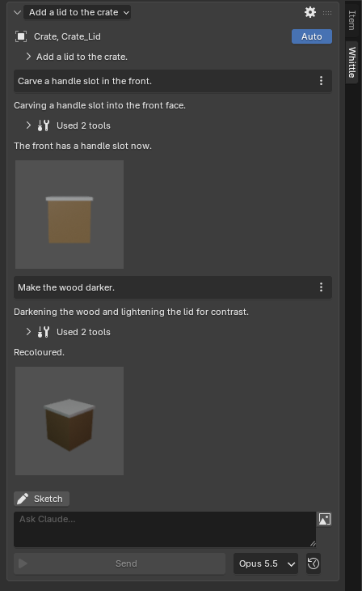
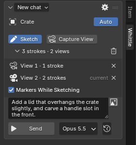
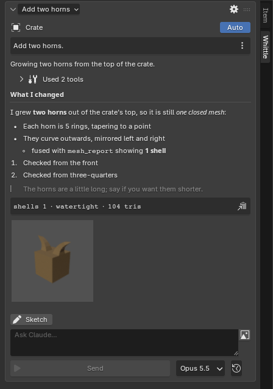
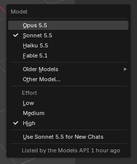
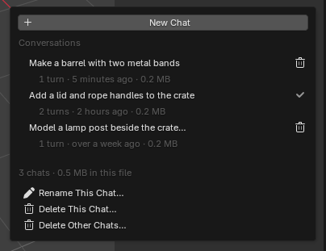
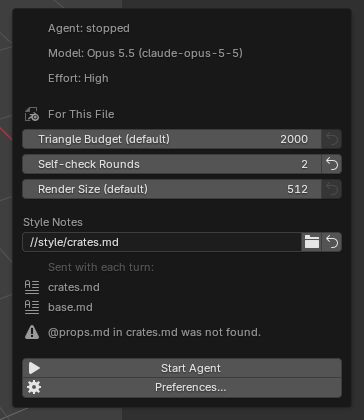

# Whittle

A Blender extension for sketch-driven modeling: orbit a model, sketch over it with Grease
Pencil, add a prompt or reference images, and a Claude agent makes the edit in your open
scene while you watch and steer. Every turn becomes a node in a branching history.

Whittle is powered by Claude, through your own Anthropic API key. It is an independent
open-source project, not made by, endorsed by or affiliated with Anthropic.

**[Read the documentation](https://imonalampshade.github.io/whittle/)**: a quickstart, a
walkthrough, the guides and an API reference. It follows `main`, so it can describe things
newer than the latest release.

## Why I made this

I made this because Claude Design is going away, and I found it extremely useful for quick modeling tasks when using my Wacom tablet to draw redlines over a 3D object. This project is the evolution of that feature. Everything here has been vibe coded over the course of a few days, so don’t expect it to be perfect - but it does everything I need it to, so I’m happy with it.


The documentation site's source is in [docs/site/](docs/site/index.md) (Documentation, below).
See [docs/design.md](docs/design.md) for the original design, [docs/architecture.md](docs/architecture.md)
for how it is built, [docs/decisions.md](docs/decisions.md) for the choices behind it,
[docs/ui.md](docs/ui.md) for the sidebar, and [docs/progress.md](docs/progress.md) for what
works today and what is still rough.

Requirements: Blender 5.2 (its Python, 3.13 or 3.14) on Linux x64 or arm64, Windows x64 or an
Apple silicon Mac, and an Anthropic API key. No one has used it for real on Linux arm64,
Windows or macOS yet: reports welcome (see [Platforms](#platforms)).

## Screenshots

| A conversation | Sketching |
|---|---|
|  |  |

| A reply in Markdown | The model menu |
|---|---|
|  |  |

| The chat menu | The agent popover |
|---|---|
|  |  |

## Status and limitations

Whittle is young (0.1.0); expect rough edges.

- **Platforms**: developed on Linux x64, with real agent turns only on a distribution's
  Blender with Python 3.14; blender.org's Python 3.13 has passed the offline suite in CI,
  not a real turn. Linux arm64, Windows x64 and
  macOS on Apple silicon are supported in the code, and the last two run in CI, but real
  use on all three is untested: reports welcome. Intel Macs are not supported. See
  [Platforms](#platforms).
- **Sign-in**: an Anthropic API key only (API key and cost). Every turn calls Claude
  and costs tokens.
- **Checked in a real GUI Blender by script**: flows background tests cannot reach, such
  as a real Ctrl+Z during a turn, strokes drawn with the real draw tool, File → Recover
  and Whittle's preferences as an installed extension, run in `./gui_checks.sh` (GUI
  checks, below). What still needs a person, such as
  tablet pressure and clicking the sidebar's own buttons, is the manual checklist in
  [docs/progress.md](docs/progress.md).

### Platforms

| Platform | Blender name | Status |
|---|---|---|
| Linux x64 | `linux-x64` | Developed here on a distribution's Blender with Python 3.14. CI gates every release on blender.org's build (Python 3.13), which has passed the offline suite but not a real agent turn. |
| Linux arm64 | `linux-arm64` | Untested: blender.org publishes no build for it, so CI cannot run it. Reports welcome. |
| Windows x64 | `windows-x64` | The agent-side tests have passed in CI, but the Blender suite cannot finish on the headless runner. Real use is untested: reports welcome. |
| macOS on Apple silicon | `macos-arm64` | The offline suite has passed in CI. Real use is untested: reports welcome. |
| macOS on Intel | `macos-x64` | Not supported. |

One zip serves all four. It carries no wheels: the agent environment is downloaded at
setup from the same hash-pinned `requirements.lock`, which holds the hashes of every wheel
of each pinned version (except `pywin32`, which only Windows installs and which has just
its Windows x64 wheels), so pip picks the files for your platform (the
`claude-agent-sdk` wheel brings `claude` there, `claude.exe` on Windows). Intel Macs are
left out because `cryptography` 50, which the lock pins, has no Intel macOS wheel, and
Blender 5.2 has no Intel Mac build. Windows on Arm is left out too: the pinned SDK has
no Windows Arm wheel. On Linux arm64 every pin that applies has an aarch64 or pure-Python wheel for
Python 3.13 and 3.14 whose hash is in the lock (checked against PyPI), but no one has run it yet,
and blender.org publishes no Blender for it.

What differs on Windows: setup steps and the agent run without a console window; the
agent and the Claude CLI it starts share a Job Object, so stopping the agent (or
Blender crashing) ends the CLI too; and a stop is graceful only through Whittle's own
shutdown message, since Windows has no terminate signal. A killed agent leaves the
SDK's `claude-resume-*` folder in the temp folder; the next agent start removes
Whittle's once they are a day old, never one a running agent may use. Only Windows installs `pywin32`:
`mcp` imports it there as it loads, so the SDK cannot start without it. Windows paths can get long (the
user folder is under `%APPDATA%\Blender Foundation\Blender\5.2\extensions\.user\…`):
if a turn fails on a path over 260 characters, turn on Windows' long path support, or
pick a shorter **Environment Folder**.

## Install

1. Download `whittle-0.1.0.zip` from the
   [latest release](https://github.com/ImOnALampshade/whittle/releases/latest). One zip serves
   every platform, and the `.sha256` beside it is its checksum. Or build it from the source:

   ```sh
   ./build.sh            # validates, then writes build/whittle-0.1.0.zip
   ```

2. Install it: in Blender, **Edit → Preferences → Get Extensions → Install from Disk…** and
   pick the zip, or from a shell:

   ```sh
   blender --command extension install-file -r user_default whittle-0.1.0.zip
   ```

3. Turn on **Preferences → System → Network → Allow Online Access**. Whittle refuses to start
   the agent, or download anything, without it.

4. Set up the agent environment: **Preferences → Add-ons → Whittle → Agent Environment → Set
   Up Agent Environment**, then confirm the dialog. (The sidebar offers the same button when
   the agent cannot start for lack of it.)

   - **What it downloads**: the 30 packages pinned in `requirements.lock` (31 on Windows, with `pywin32`), among them
     Anthropic's `claude-agent-sdk` 0.2.167, whose wheel bundles the Claude CLI that
     runs the agent. They come from PyPI, as prebuilt wheels.
   - **How**: Whittle makes a venv from Blender's own Python (`sys.executable -I -m venv`), then
     runs
     `pip install --isolated --disable-pip-version-check --no-input --no-cache-dir --index-url https://pypi.org/simple --progress-bar raw --require-hashes --only-binary :all: --no-deps -r requirements.lock`
     inside it. Every file must match a hash in the lock, nothing is built from source (so no
     package's setup code runs), and nothing beyond the lock is resolved. `PIP_*`, `PYTHON*`,
     `UV_*`, `VIRTUAL_ENV` and `CONDA_*` variables are dropped for these steps, and `--isolated`
     skips your own pip config, so neither can point pip at another index. `--index-url`
     overrides the index a system-wide pip config names, so a mirror set there does not apply
     and setup fails where pypi.org is blocked. That config's proxy and CA still apply, and so do
     its `extra-index-url`, `find-links` and `no-index`, which no flag undoes; the hashes hold
     either way. Proxies (`HTTPS_PROXY`) and `SSL_CERT_*` are kept.
   - **Slow connections**: the `claude-agent-sdk` wheel is about 114 MB. The status line shows
     its download progress, and the install is only stopped if no data arrives for 5 minutes
     (or after 3 hours in all), so a slow but working connection gets there.
   - **Where**: the extension's user folder, `~/.config/blender/5.2/extensions/.user/user_default/whittle/venv`
     on Linux (under `%APPDATA%\Blender Foundation\Blender\5.2\` on Windows and
     `~/Library/Application Support/Blender/5.2/` on macOS), unless you pick another
     **Environment Folder** first. The log of each setup is in
     `…/whittle/logs/venv-<time>.log`.
   - **Updates**: Whittle never upgrades anything by itself. After an extension update that
     ships a different lock, the preferences (and the sidebar) say the environment was set up
     for an earlier version; press **Reinstall** to rebuild it from the new lock.

5. Add your API key (next section).

## API key and cost

Whittle runs Claude only with an Anthropic API key, as Anthropic's terms ask of
products built on the Agent SDK. It cannot use a Claude.ai login or a Free, Pro or Max
plan, and it never reads the Claude configuration in your home folder.

1. Make a key in the [Claude Console](https://platform.claude.com/settings/keys)
   (**Get an API Key** in Whittle's preferences opens that page). The Console account
   needs API credits; API usage is billed separately from any Claude subscription.
2. Paste it into **Preferences → Add-ons → Whittle → Anthropic API Key**.

Or leave the preference empty and start Blender with `ANTHROPIC_API_KEY` in its
environment. A key in the preferences wins over the environment; the preferences say
which one is in use. Without either, the agent does not start and the sidebar asks for a
key.

The key is kept in Blender's preferences (saved with them in `userpref.blend`) and handed
to the agent process in its environment; Whittle writes it nowhere else and never logs
it. The agent's environment drops every other Claude or Anthropic credential, and the
bundled CLI runs with a configuration folder of Whittle's own
(`…/extensions/.user/user_default/whittle/claude/`), so it never sees your own Claude
login, settings, hooks or MCP servers.

**Cost**: every turn is billed to the key's account at the model's API price. A finished
turn's cost is the dim last line of its last tool group (open **Used N tools**:
`3 steps · $0.0123`), and every turn's is in its transcript. The model, the **Self-check
Rounds** and the **Render Size** are the main levers: Fable is the most capable and the most
expensive per token, then Opus and Sonnet, with Haiku the cheapest, and each self-check round
sends renders back to the model. A style guide's text goes with every request, so keep guides
short. Set spending limits in the Console.

**Model for New Chats** is the model a new chat starts on, `claude-opus-5-5` by default;
it suggests the models last reported for your key and the ones Whittle knows, and takes any other model id. The **Defaults** box
sets what every session starts with: the triangle budget, self-check rounds and render
size, and **Style Notes**, the path to a style guide. A file can set its own value for
each of them in the agent popover (the icon at the right of the panel's header) under
**For This File**: an unset one shows the preference's value and says "(default)", and the
reset button beside a set one goes back to it. They are saved with the .blend.

A style guide is a `.md` or `.txt` file saying how things should look: colours, edges,
materials, mood, in your own words. Many `.blend` files can point at one guide, and a guide
can import others with a line holding only `@path`, so a project's base look is written
once. `//` at the start of the path means the `.blend`'s folder, and a file's first save
turns a picked path into one where it can, so it works on a clone; a saved file's absolute
path has a warning. Empty leaves the look to Claude. Claude reads the guide as your preferences for that file, not as rules: a request's
prompt or sketch still wins. Only `.md` and `.txt` files load, up to 128 KiB in all, since
a `.blend` from someone else could name any file on your computer; the agent popover names
what is sent, the first ten files and then how many more. For the same reason Send stays disabled
for a guide this computer has not approved, under a box with **Use This Guide**, **Read Now**
and **Go Without It**: you are asked once per guide on each computer, not once per file, and
nothing is added to the `.blend`. Choosing a guide yourself counts as approving it, and approving
it covers what it imports. A file that cannot load is a warning, and the turn still runs. Guides are read
again before each turn, so an edit applies from the next one.
[Style guides](docs/site/guides/settings.md#style-guides) has a worked example.

## Use

Open the 3D viewport sidebar (N) → **Whittle**. It reads like a chat: what Claude is working
on, the conversation, a sketch strip and a prompt box. The panel's header shows the
current chat's title (click it for the chat menu, step 8); the icon beside it is the
agent's state: click it for that state, the chat's model and effort, this file's settings,
Start/Stop and the Preferences.

1. **Target**: with **Auto** on (the default) Claude works on whatever is selected (or the
   active object); with nothing at all it makes new objects. Turn Auto off to pick targets
   by hand, or to name a collection.
2. **Start from** (shown until the first turn, optional):
   - **Selection**: the selected objects, as they are, are the target and history node 0.
   - **Blank**: this scene as it is, with nothing selected and nothing targeted, so Claude
     makes new objects. Nothing is added to the scene.
   - **Primitive**: a cube, cylinder, sphere, … standing at the 3D cursor.
   - **Asset Browser**: right-click an object or collection asset → **Start Whittle From Asset**.
   Typing a prompt and pressing Send works too: node 0 is the scene as it is.
3. **Sketch**: press Sketch and draw over the model, as you would redline a drawing. Your
   prompt says what the marks mean. Strokes stick to surfaces, and off a surface they land
   on the view plane at the 3D cursor. Orbit and draw from more angles: each angle
   becomes a view, marked in the viewport by a small camera while you sketch. Click a
   marker (or the view's row under the stroke count) to go back to that view.
   Keys for a tablet's express keys, over the viewport in any mode: **Shift+Alt+D**
   toggles Sketch mode, **Shift+Alt+V** captures a view and **Shift+Alt+Enter** sends (and, while Claude works, amends the turn
   with what you typed or drew since). Rebind them in Preferences → Keymap
   (3D View → 3D View (Global)).
4. **Describe**: type a prompt (Shift+Enter adds a line); the image button beside the prompt
   box adds reference images. Click a reference's chip to pin it, so it goes with every
   request, or to place it in the scene as a half-transparent image empty.
   **Shift+Alt+C** from anywhere, in any mode, opens the sidebar and a prompt field under
   the pointer, ready to type with no mouse: Enter sends, Esc closes. While a turn runs it
   amends the turn, and while Claude asks it answers. Rebind it in Preferences → Keymap
   (Window → Ask Claude).
5. **Model**: the button beside Send (`Opus 5.5 ▾`) picks the model this chat runs on,
   from its next turn: the newest of each family (Opus, Sonnet, Haiku, Fable), older
   versions under **Older Models**, or **Other Model…** for any id. The list is the one
   the Models API reported for your key when the agent last started, kept in Whittle's
   user folder; before that, a built-in list. The same menu sets the chat's **Effort**,
   how much Claude thinks: High by default, Low or Medium for quicker, cheaper turns on
   small edits.
6. **Send** (Enter, or the Send button), then watch the turn. While it works, type into the
   field or draw more strokes and press Enter, Shift+Alt+Enter or **Amend**,
   answer Claude's questions, or **Stop ▾** (keep the changes or undo the turn).
7. **History** lives on the turns: each turn's ⋮ menu has Edit & Resend (a new branch), Go
   Back, Compare, Ghost, Open Render and Open Transcript, and ‹ 1/2 › switches between
   branches. The 🕘 button beside Send shows the whole tree.
8. **Chats**: the title in the header opens the chat menu. **New Chat** starts an empty
   conversation with a fresh Claude session and its own history, from the scene as it
   is. Clicking an earlier chat goes back to its conversation and Claude session; the
   scene stays as it is (its history is there to go back to a turn by hand). Each chat
   shows its turns, age and the size it adds to the file. Delete one with its 🗑, or
   many with **Delete Other Chats…** (all, or older than a week, a month or three
   months); either asks first. Each chat keeps its own model.

Every chat is stored inside the `.blend` when you save, so the file alone carries them all,
and nothing is written beside it. That includes everything in them: your prompts, Claude's
replies and the code it ran, your reference images and its renders. Before you share a
`.blend`, delete its chats, or turn off **Preferences → Add-ons → Whittle → Files → Save
Chats in the .blend** (chats then stay in this computer's cache, and files saved from then
on carry none). While you work, Whittle keeps a hidden copy in its own
user folder (`cache/<file id>/`), named by an id the file stores, so it follows the file
when it is renamed or moved; a copy of the file gets a cache of its own. Opening the file
fills the cache from it and the file wins, except after a crash: chat work newer than
the last save is kept. Caches not used for 30 days are deleted. A deleted chat leaves the
file at the next save, so old chats do not keep it large. The same file open in two
Blenders gets a cache in each, and a quiet line in the sidebar says their chats will not
merge.

A chat that was made on another machine (someone else's file, or your own from another
computer) opens with a box asking **Continue this chat?**: Send stays disabled until you
press **Continue**, and **New Chat** is there instead. You are asked once per
chat; chats from files saved before Whittle recorded this never ask. The mark is a random
id Whittle keeps for its install in its user folder (`install.json`); it names no person
or machine.

`./gui_checks.sh` walks through most of these in a real Blender (GUI checks, below), and
[docs/progress.md](docs/progress.md) has a manual checklist for the rest.

## Privacy and safety

Whittle talks to Anthropic's API only, with your key, while the agent runs: a model
listing when it starts, then the turns. The bundled Claude CLI can also send
Anthropic its own usage telemetry and error reports; Whittle turns that off by running it
with `CLAUDE_CODE_DISABLE_NONESSENTIAL_TRAFFIC=1`. **Preferences → Add-ons → Whittle →
Send Claude CLI usage data** (off by default) turns it back on, unless Blender's own
environment sets that variable. What a turn sends:

- your prompts, amendments and answers to Claude's questions, and the reference images
  you attach or pin;
- the sketch: the strokes with their positions, the camera of each view, and
  the overlay images of your strokes over the viewport;
- what Claude looks at while it works: scene information it asks for (object names,
  transforms, mesh statistics, materials, modifiers, node groups), the output and errors
  of the Python it runs, and the self-check renders it makes of the target;
- details of the request: the target's object names, this file's triangle budget and
  self-check rounds, the file names of your references, and folder paths on your computer,
  which can include your user name;
- the text of the style guide, if the file has one and you approved it: every file it loads,
  of which the agent popover names the first ten and counts the rest;
- Whittle's system prompt and recipe skills, and the conversation so far.

Anthropic's handling of API data is set out in its
[privacy policy](https://www.anthropic.com/legal/privacy) and
[commercial terms](https://www.anthropic.com/legal/commercial-terms). Conversations are
also kept locally, in the chat cache and in the `.blend` when you save it, so a shared
`.blend` carries its chats (delete them from the chat menu first if that matters).

## Security

- **Claude runs Python as you.** The agent edits the scene by running Python inside your
  Blender, unsandboxed and without asking each time: it can do anything you can, such as
  read and write your files, start programs and reach the network. That is what lets it
  model, and it is also why what it reads matters.
- **Be careful with files you did not make.** Claude reads the scene (object, material
  and collection names), your reference images, the style guide and, when you continue a
  chat, that chat's whole conversation. A `.blend` from someone else can carry chats too, and continuing
  one replays its conversation to Claude as if it were its own. Text planted in any of
  these could try to steer Claude. That is why a chat made on another machine asks
  before it sends anything (see Use): start a **New Chat** on a file from elsewhere
  rather than continuing its chats, and do not run Whittle on files you do not trust.
  The `.blend` also stores the path of its style guide, and what that loads is sent with your
  turns, so a guide this computer has not approved asks first: press **Read Now** to see what it
  would send before **Use This Guide**.
- Blender's **Auto Run Python Scripts** setting does not cover Whittle: it only stops
  scripts stored in a file. Nothing Whittle stores in a file runs code by itself.
- Links in Claude's replies open only `http`, `https` and `mailto` addresses.

## Development

You need Blender 5.2 as `blender` on your `PATH`: `run_tests.sh`, `build.sh`,
`screens.sh` and `gui_checks.sh` run it from there. They are POSIX shell scripts that use
`timeout` (GNU coreutils; on a Mac, `brew install coreutils` provides it), and `screens.sh`
and `gui_checks.sh` need Linux with KDE's `kwin_wayland`. On Windows, run the commands
they contain by hand (the dev venv's Python is `.venv\Scripts\python.exe` there).

- Make the dev venv `.venv/` at the repo root once, from Blender 5.2's own Python (in
  Blender's folder, `5.2/python/bin/python3.13` in blender.org's builds, or a system
  Python 3.14 when your Blender uses that), and install the pinned lock exactly as the add-on does:

  ```sh
  PY=/path/to/blender-5.2/5.2/python/bin/python3.13
  "$PY" -I -m venv .venv
  .venv/bin/python -m pip install --isolated --disable-pip-version-check --no-input \
      --no-cache-dir --index-url https://pypi.org/simple \
      --require-hashes --only-binary :all: --no-deps -r agent_env/requirements.lock
  ```

  Use `.venv/bin/python` for agent-side code. **Never install anything else into it**: no
  other packages, no upgrades.
- Point the add-on at it instead of setting up a private venv:

  ```sh
  export WHITTLE_AGENT_PYTHON="$PWD/.venv/bin/python"
  ```

  (or set **Development → Agent Python** in the preferences).
- Work on the source in place by symlinking the package into a local extensions repository:

  ```sh
  ln -s "$PWD/whittle" ~/.config/blender/5.2/extensions/user_default/whittle
  ```

  then enable Whittle in **Preferences → Add-ons** and restart Blender after code changes.
- To try the UI without the API (and without a key), turn on Preferences → Interface →
  **Developer Extras** and set the sidebar's **Development → Fake Script** to a script
  under `tests/fixtures/fake/` (e.g. `stream.json`, `ask.json`); Send then plays it.
- `whittle/requirements.lock` must stay a byte-identical copy of `agent_env/requirements.lock`;
  `build.sh` and a test check it.

Environment variables Whittle reads:

| Variable | What it does |
|---|---|
| `ANTHROPIC_API_KEY` | The API key, when the preference is empty (API key and cost). |
| `WHITTLE_AGENT_PYTHON` | The Python that runs the agent, over the preference and the private venv. |
| `WHITTLE_USER_DIR` | Whittle's user folder (chat caches, the venv, logs, the model list). Point it at a scratch folder to keep manual dev runs out of your real one. |
| `WHITTLE_LOG_LEVEL` | The agent's logging level (`INFO` by default; `DEBUG` for more). Its log is in the user folder's `logs/`. |
| `WHITTLE_INLINE_SKILLS` | `1` puts the recipe skills into the system prompt instead of loading them as a plugin. |
| `WHITTLE_LIVE` | `1` makes `run_tests.sh` run the live tests too (Tests). |
| `WHITTLE_SCREENS_VISIBLE` | `1` makes `screens.sh` show its windows on your desktop (Sidebar screenshots). |
| `WHITTLE_GUI` | `1` makes `run_tests.sh` run the GUI checks too (GUI checks). |
| `WHITTLE_GUI_VISIBLE` | `1` makes `gui_checks.sh` show its windows on your desktop (GUI checks). |
| `WHITTLE_DOCSHOTS_SLOTS` | How many Blenders `docs_shots.sh` runs at once across the machine (Documentation). |


### Sidebar screenshots

```sh
./screens.sh                       # every scenario, several minutes
./screens.sh conversation asking   # only these
./screens.sh --docs                # the README's images, into docs/images/
```

`screens.sh` opens a real GUI Blender (`--factory-startup`, one at a time, each under a
120 s timeout, quitting by itself) per scenario in `tests/screens/catalog.py`. Each
scenario builds a scene, drives the fake agent through the add-on's own controller to a
state (a finished turn, a question, a turn mid-stream, a branched history, …) and the
harness crops the Whittle sidebar out of a screenshot, scrolling and stitching when the
panels are taller than the window (`view_markers` shoots the viewport instead, and `hero`
the whole 1600×1000 window). Results go to `build/screens/<scenario>.png`, plus
`build/screens/wide/` for `conversation`, `markdown` and `long_session` with a 1.6× wider
sidebar, and `build/screens/index.json` describing each image.

The README's images are committed under `docs/images/`, since `build/` is not. After a
change to how the sidebar looks, regenerate them with `./screens.sh --docs`, which shoots
just those scenarios (`DOCS` in `tests/screens/catalog.py` says which file comes from
which shot) and copies them there; look at each before you commit it. The script exits non-zero if any image is missing; a failed
scenario's Blender log is in `build/screens-work/<scenario>/blender.log`. Blender's user
folders point into `build/screens-work/`, so the runs never touch your own preferences or
recent files. The windows open in a hidden, nested Wayland session (`kwin_wayland
--virtual`, KDE's compositor, started on first use and reused after), so nothing shows on
your desktop; without `kwin_wayland` the script stops and says so (use
`WHITTLE_SCREENS_VISIBLE=1` on other desktops). `WHITTLE_SCREENS_VISIBLE=1` shows
the windows on your desktop instead (without taking focus; they ignore real input while
they run).

### GUI checks

```sh
./gui_checks.sh                         # every check, about four minutes
./gui_checks.sh undo_turn blank_sketch  # only these
WHITTLE_GUI=1 ./run_tests.sh            # the whole suite, then every check
```

Some things only a GUI Blender does: a real Ctrl+Z (undo needs a window), the draw tool
placing strokes on surfaces, a transform's modal operator, the Asset Browser's context
menu, file browsers (a reference's, Style Notes'), Blender's autosave and File → Recover, the title bar's `*`, the
Preferences window.
`gui_checks.sh` first builds the extension with `build.sh` and installs it the way you
would, with `blender --command extension install-file`, into a local extension
repository of the run's own (`build/gui-checks/gui_checks/`), so every check runs the
installed copy and the Preferences show its preferences. It then runs each check in
`tests/gui/catalog.py` in a real GUI Blender started with `--enable-event-simulate`, in
the same hidden nested session as `screens.sh`: the check builds a scene, drives the
add-on with the fake agent, sends the input under test (a key, a drag of the draw tool, a
right-click) as simulated events through Blender's own event handling, and asserts what
came of it. A check that needs a restart, a crash or Blender's own recovery files runs
one Blender per phase (a crash is a `kill -9` of Blender itself), sharing a work folder.
The preference checks (`preferences_key`, `preferences_environment`,
`preferences_defaults`) read what Blender's own redraws of the Preferences, the sidebar
and the agent popover drew; they use fake API keys and stand-in agent environments
only, never download anything, and Blender runs them without online access. Blender's
user folders, its temporary folder and Whittle's user folder are the run's own, under
`build/gui-checks/`, so nothing touches your preferences, extensions, recent files or
autosaves. The script exits non-zero if any check failed; each phase's Blender log is in
`build/gui-checks/<check>/phase-<n>.log`, the preference checks leave screenshots of
what they checked beside it, and `build/gui-checks/report.json` lists the results.
`WHITTLE_GUI_VISIBLE=1` shows the windows on your desktop instead (they ignore real
input while they run).

## Tests

```sh
./run_tests.sh                 # the whole offline suite; add -v for verbose
./run_tests.sh -k test_start   # only tests whose name matches
WHITTLE_LIVE=1 ANTHROPIC_API_KEY=… ./run_tests.sh  # also the live tests
```

`run_tests.sh` runs the agent-side tests under `.venv/bin/python`, then the Blender-side tests
inside `blender -b --factory-startup`, each step under a `timeout`. Tests use the stdlib
`unittest` only (pytest is not installed) and a scripted fake agent, so the offline suite
needs no key, makes no network calls and never installs anything: the venv setup is
tested through its command construction, a fake process and a dry run.

With `-k`, each side runs only the tests whose name matches; a side where nothing matches
is skipped, and the script fails (exit code 5) only when no test matched on either side.
`WHITTLE_GUI=1` runs the GUI checks after both sides (GUI checks).

The live tests call the real API with `ANTHROPIC_API_KEY` (a few US cents per run, billed
to that key): they use `claude-haiku-5-5` with a tiny prompt, and `run_tests.sh` adds
`--online-mode` to Blender for them.

## Documentation

The [documentation site](https://imonalampshade.github.io/whittle/) is a Sphinx project in
`docs/site/`: a quickstart, a walkthrough, a guide per topic, the development pages and an
API reference generated from the source. CI publishes it from `main` (CI and releases, below).
None of it ships in the extension. It has a venv of its own, `.venv-docs/` (gitignored), made from
its own hash-pinned lock, `docs/site/requirements.lock`; the build needs neither Blender nor
the network.

```sh
python3 -m venv .venv-docs
.venv-docs/bin/pip install --require-hashes --only-binary :all: --no-deps -r docs/site/requirements.lock
./docs.sh                      # the site, into build/docs/html
./docs.sh --strict             # every page rebuilt, warnings are errors
./docs.sh --out DIR            # html and doctrees wholly in DIR
./docs_shots.sh guides-undo    # a page's screenshots; add shot names for only those
./docs_shots.sh --all          # every page's, about 6 minutes
./docs_shots.sh --list         # every shot; --check validates the specs. Neither launches Blender
```

Each page's screenshots come from a spec, `docs/site/shots/<page-slug>.py`, where the slug
is the page's name with `/` as `-`, and land in `docs/site/images/<page-slug>/`. They are
committed. `docs/site/shots/README.md` is the guide to writing a spec. `docs_shots.sh` runs
from `.venv` and needs `kwin_wayland`: every Blender gets a hidden session of its own and
folders of its own under `build/docs-shots/`. `WHITTLE_DOCSHOTS_SLOTS` sets how many run at
once; each holds GPU memory, and shots fail if the card runs out. [Development setup and testing](docs/site/develop/setup-and-testing.md) has the details.

## CI and releases

GitHub Actions runs on GitHub's free standard runners and needs no secrets.
`.github/workflows/ci.yml` runs on pushes to `main` and `ci/**` and on pull requests;
`release.yml` runs on tags. Both call `test.yml`, which downloads a pinned Blender
from download.blender.org, or a public mirror if that refuses the runner
(`.github/scripts/fetch_blender.py` checks its SHA-256 before unpacking it), makes `.venv` from Blender's Python, installs the lock, and runs
`./run_tests.sh` and `./build.sh`. The GUI checks and screenshots are not part of CI: they
need `kwin_wayland`.

`docs.yml` publishes the documentation site. On a push to `main` that changes what the site
is built from, or when started by hand, it makes `.venv-docs` from the hash-pinned lock, runs
`./docs.sh --strict`, and a second job deploys the result to GitHub Pages at
<https://imonalampshade.github.io/whittle/>. A push to `ci/**` touching those paths builds
without deploying, and so does starting it by hand on another branch. Nothing waits for it: a
failure leaves the site as it was until the next good build, and holds back neither CI nor a
release. It needs one setting, made once by hand before `docs.yml` first reaches `main`:
Settings → Pages → Build and deployment → Source: GitHub Actions. If that push comes first,
its deploy job fails and the setting starts nothing, so start `docs.yml` by hand on `main`
afterwards.

Linux x64 (`ubuntu-latest`) is the gate. Windows x64 and macOS on Apple silicon run too,
but their failures count for nothing yet, and a release does not wait for them. Linux
arm64 has no CI: blender.org publishes no Linux arm64 build. [Platforms](#platforms) says how
far each one has got.

To cut a release:

1. Set `version` in `whittle/blender_manifest.toml` and merge that to `main`.
2. Tag that commit `v` plus the version and push the tag:

   ```sh
   git tag v0.2.0
   git push origin v0.2.0
   ```

The tag must match the manifest, or the release stops at once. When the tests pass,
`whittle-<version>.zip` and its `.sha256` are attached to a new GitHub Release. A tag with
a hyphen, such as `v0.2.0-rc1`, publishes a prerelease of the manifest's `0.2.0`.

## Contributing

Issues and pull requests are welcome; [CONTRIBUTING.md](CONTRIBUTING.md) has the details.
[AGENTS.md](AGENTS.md) is the short working guide to the repo (layout, commands, hard
rules, where to start a common change), for coding agents and new contributors alike.
Before you send a change, run `./run_tests.sh` (and `./screens.sh` for sidebar changes,
looking at the images), keep `README.md` and `docs/` in step with what you change, and
follow the supply-chain notes below: no new or upgraded dependencies without discussing
them first.

## Supply-chain notes

- Every dependency is pinned to an exact version with hashes, installed from wheels only and
  without dependency resolution. Nothing is ever upgraded automatically, and there are no
  `github:` or VCS references.
- The install only runs after you confirm the dialog, never during a turn (so the agent's own
  Python can never start one), and never from background Blender.
- The bundled Claude CLI is run as Anthropic ships it, unmodified.
- A change to `agent_env/requirements.lock` (or its packaged copy) in a diff that should not
  touch dependencies is a red flag: stop and look at it.
- Whittle never publishes anything.

## License

Whittle is free software: you can redistribute it and/or modify it under the terms of the
GNU General Public License as published by the Free Software Foundation, either version 3
of the License, or (at your option) any later version. See [LICENSE](LICENSE).

It downloads and runs third-party packages under their own licenses, among them
Anthropic's Claude Agent SDK and the Claude Code CLI it bundles, whose use is governed by
[Anthropic's Commercial Terms of Service](https://www.anthropic.com/legal/commercial-terms).
"Claude" and "Anthropic" are trademarks of Anthropic, PBC.
