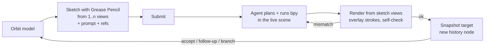
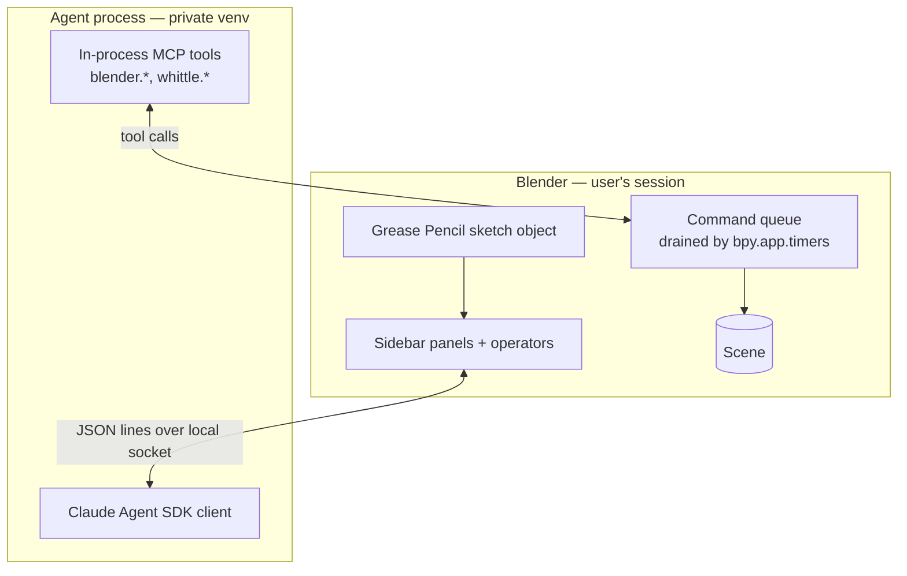

# Whittle

> [!WARNING]
> **The original design.** This is the design Whittle started from. Where they differ, `decisions.md` and
> `architecture.md` win, and `progress.md` says what is built. Superseded here: the target
> lock (removed), the `<name>.whittle/` folder beside the `.blend` (chats now live inside
> the `.blend` and a hidden cache), Blank's ground grid and scale reference (Blank adds
> nothing), and Blender 4.2 (5.2 is required).

A **Blender extension** for AI-assisted modeling. You orbit a model, **sketch over it with Grease Pencil**, optionally add a text prompt or reference images, and a Claude agent (Anthropic **Agent SDK**) makes the edit in your open Blender scene. You watch it happen, steer it mid-turn, and every completed turn becomes a node in a branching history.

First target: **game props** — hard-surface / low-poly objects (lanterns, crates, trees, fences) built with bmesh and modifiers.

> [!NOTE]
> **Why an extension, not a standalone app.** The first draft was a standalone app driving headless Blender. Blender already provides almost all of that app: tablet sketching with pressure, strokes projected onto surfaces, a viewport, undo, materials, geometry nodes. Running inside Blender removes the bake-and-reload round-trip and the second copy of the model, and roughly halves the build.

### Decisions

| Topic | Decision |
|---|---|
| Host | Blender extension (Blender 5.2+) |
| Scope | Game props first: bmesh + modifiers, low-poly |
| Sketching | Grease Pencil, Surface placement, one layer per stroke type |
| Strokes | Free by default, **optional** stroke types |
| Agent reach | Mesh geometry, new objects, materials & UVs, geometry nodes |
| Interaction | Watch and steer: live stream, interrupt / amend mid-turn |
| History | Branching snapshot tree |
| Multi-view | Yes — strokes from several angles in one request |
| Start points | Existing scene, blank + sketch, reference images, primitive/asset library |
| Verification | Agent self-check: render from sketch cameras, overlay, compare |
| Materials | Vertex colours / flat materials first, textures later |
| UI | 3D viewport sidebar tab ("Whittle") + history panel |

---

## 1. Core loop



1. **Pick a target**: the object(s) or collection Whittle edits.
2. **Sketch**: Draw mode on the Whittle sketch object. Orbit and draw more; Whittle records a **view** (camera) each time you sketch from a new angle.
3. **Describe** (optional): prompt in the sidebar, reference images attached.
4. **Submit**: Whittle builds a *request bundle* (§3) and sends it to the agent.
5. **Watch & steer**: geometry changes live in the viewport; the sidebar streams agent text and tool calls; renders open in an Image Editor. Interrupt or amend at any time.
6. **Result**: the turn becomes a history node. Accept, follow up (same conversation), or restore an earlier node and branch.

---

## 2. Architecture



### Why the agent is a separate process
- **bpy is single-threaded** and must only be touched on Blender's main thread. The Agent SDK is asyncio-based and spawns its own CLI subprocess; running it inside Blender's interpreter would mean an event loop fighting the UI.
- **Dependency isolation**: the SDK and its dependencies live in a private venv the extension manages, not in Blender's bundled Python.
- **Crash isolation**: an agent crash or hang never takes Blender down.

### The bridge
- The extension starts the agent process and opens a local socket.
- A `bpy.app.timers` callback polls the socket each tick (non-blocking), runs queued commands **on the main thread**, and replies. Same for streaming events going the other way (text, tool calls, status → sidebar).
- Long-running bpy work (renders) blocks the UI briefly; keep renders small and fast (Workbench / EEVEE, low resolution).

### Concurrency with the user
The agent edits the live scene while you can still orbit and sketch. Rules:
- ~~During a turn the **target is locked**~~ (removed: Whittle neither watches nor blocks the user's edits during a turn; `decisions.md`). Camera, sketching and other objects stay free.
- Sketching during a turn goes into a **pending** set of strokes for the next request (or into an *amend*, §4).

---

## 3. Sketching with Grease Pencil

### Setup
- A **Whittle Sketch** Grease Pencil object per session, placement mode **Surface** (strokes stick to the target's surface; strokes off the surface fall back to the view plane at the cursor depth).
- Tablet pressure, eraser end, and strength are Blender's own. Map tablet buttons to Whittle operators via normal keymaps (submit, next stroke type, capture view).

### Stroke types: free by default, typed for precision
One **layer per type**, each with its own colour. Drawing on the default layer = free.

| Layer | Meaning to the agent | Colour |
|---|---|---|
| free | interpret with the prompt | white |
| add / outline | "the shape should reach here" | green |
| carve | remove material | red |
| crease | hard edge / loop cut / bevel line | yellow |
| region | prompt applies to this area (fill) | blue |
| note | annotation (arrows, circles); never geometry | grey |

A sidebar row of type buttons switches the active layer.

### Views
A view = a camera snapshot (view matrix, projection, viewport size). Whittle captures one automatically when you start drawing from a substantially new angle, or explicitly with **Capture View**. Strokes are tagged with the view they were drawn from (stroke attribute / frame metadata). Views can be shown as small camera gizmos and clicked to snap back.

### Request bundle (per turn, on disk)

```
<chat folder>/nodes/<node-id>/request/      # superseded: was <blend name>.whittle/ beside the file
  request.json      # prompt, parent node, target names, stroke types used, refs
  views/
    0/camera.json   # view, projection, size
    0/overlay.png   # viewport render with strokes composited
    0/strokes.png   # strokes only, transparent
    1/...
  strokes.json      # every stroke: type, view id, points (world xyz),
                    # on-surface flag + normal, pressure
  refs/             # reference images
```

Strokes are already in world space (Grease Pencil gives us the projection), so the agent gets exact coordinates plus the images it needs to *see* intent.

---

## 4. The agent

### Harness
- Claude Agent SDK, Python, one `ClaudeSDKClient` conversation **per session** so follow-ups keep context; the session id is stored with the history so it can resume after Blender restarts.
- System prompt: Whittle conventions (scale and units, a loose triangle budget, material rules, naming, "sketch is intent, not exact geometry", stroke-type meanings, don't touch objects outside the target unless asked).
- Built-in file/shell tools off; the agent works through Whittle tools only.
- bpy recipe **skills**: mesh check, fuse parts, blockout from silhouette, extrude along stroke, boolean carve, bevel/crease edges, mirror/array, lathe from profile, vertex-colour painting, geometry-node scatter.
- Modeling practice in the prompt: parts that belong together become one closed shell, never a part buried in the body; defaults with reasons rather than hard rules (see [modeling-practices.md](modeling-practices.md)).

### Tools (in-process MCP server in the agent process, executed via the bridge)
| Tool | Purpose |
|---|---|
| `blender.exec(code)` | Run bpy in the live scene; returns stdout, errors, and a short scene diff |
| `blender.inspect(query)` | Objects, modifiers, counts, bounds, materials, node trees |
| `blender.render(view_id \| camera, mode)` | Render from a sketch view or a new camera; modes: shaded, wireframe, matcap, **overlay** (strokes composited) |
| `blender.checkpoint(label)` | Mid-turn restore point (see §6) |
| `whittle.request()` | The current request bundle (images returned as image content) |
| `whittle.ask(question)` | Ask the user; shows in the sidebar and pauses the turn |

### Turn shape
1. Read the bundle (overlays, world-space strokes, prompt, refs).
2. Inspect the target.
3. Short plan (streamed).
4. Edit in small `blender.exec` steps.
5. **Self-check**: render overlays from every sketch view, compare against the strokes, fix and repeat (capped rounds).
6. Finish → Whittle snapshots the target and creates the history node.

> [!WARNING]
> **Self-check bias.** Self-check was picked over a separate critic subagent for cost and simplicity. If the agent grades itself too kindly, the upgrade is a critic subagent that sees only sketch, prompt and fresh renders — never the edit transcript.

### Watch & steer
- Sidebar stream: assistant text, collapsed tool calls (expand to see code), render thumbnails (click to open in an Image Editor).
- **Interrupt**: stop at the next checkpoint; restore the turn's starting snapshot, or "keep partial".
- **Amend**: queue a message (and any newly drawn strokes) into the running turn.

---

## 5. UI

> The sidebar was redesigned as a chat; `docs/ui.md` is its spec and supersedes the panel
> list below, which records the original plan.

- **3D viewport → Sidebar (N) → "Whittle" tab**
  - Target picker, session status, agent connection.
  - Stroke type buttons, Capture View, view list.
  - Prompt box, reference image list, **Submit**.
  - Stream (latest N entries; full transcript opens in a Text Editor block).
  - Interrupt / Amend.
- **History panel**: the branch tree as an indented list with thumbnails (Blender UI can't draw a free-form graph easily; a GPU-drawn overlay is a possible later upgrade). Restore / branch / compare buttons.
- **Preferences**: auth (an Anthropic API key), model choice, venv location, poly budget and style defaults, self-check round cap.

Blender's UI is plainer than a web panel — that's the accepted trade.

---

## 6. History

- **Branching tree**. Each node stores:
  - the target datablocks written with `bpy.data.libraries.write()` (only the target objects, meshes, materials, node groups — not the whole file),
  - the request bundle, transcript slice, and a thumbnail.
- **Restore** a node: remove the current target datablocks, append the node's from its library file. Your other scene content is untouched.
- **Branch**: submitting from a restored non-leaf node creates a sibling branch. The agent is told it is at node X and that edits on other branches don't exist (or the SDK session is forked from that point — decide during build).
- **Compare**: toggle between two nodes, or show the parent as a ghost (wireframe/transparent duplicate).
- Blender's own undo still works within and around turns; each finished turn also pushes one undo step.
- `blender.checkpoint` uses the same library-write mechanism mid-turn so the agent can back out of a bad step.

```
<chat folder>/          # inside the .blend and a hidden cache; was <blend name>.whittle/
  session.json          # tree, current node, agent session id, views
  nodes/<id>/target.blend, thumb.png, request/, transcript.jsonl
  refs/
```

---

## 7. Starting points

- **Existing scene**: pick target objects; that state is node 0.
- **Blank + sketch**: the scene as it is with nothing targeted; nothing is added (an early plan had a ground grid and a scale reference). First sketch + prompt makes the blockout.
- **Primitive / asset library**: start from a primitive or an asset from Blender's Asset Browser.
- **Reference images**: attached per request or pinned to the session; also placeable as Blender reference empties.

---

## 8. Packaging

- Blender 5.2+ **extension**: `blender_manifest.toml`, declared permissions `network` (API calls) and `files` (session folder, venv).
- The agent's Python environment is a **private venv** the extension creates on first run (user-confirmed), with an exactly pinned `claude-agent-sdk` and its pinned dependencies. Verify whether the SDK bundles the Claude Code CLI or needs it installed separately.
- Supply-chain hygiene: pinned versions with hashes, no auto-upgrade, install scripts reviewed.

---

## 9. Build phases (rough)

1. **Agent + bridge**: agent process, socket bridge, timer-driven command queue, `exec`/`inspect`/`render`; drive it from a hand-made request bundle. Self-check loop working.
2. **Sketch capture**: Whittle Sketch object, type layers, view capture, bundle writer.
3. **Sidebar + steering**: prompt, submit, stream, interrupt, amend, `whittle.ask` (and a target lock, since removed).
4. **History**: per-node library snapshots, restore, branch, compare.
5. **Starting points + preferences + packaging**.

Each phase gets tests run with `blender -b` (bridge round-trip, bundle contents, snapshot/restore fidelity, history tree ops).

---

## 10. Open questions

- **Agent SDK in a venv**: which Python runs the agent process (Blender's bundled interpreter in a venv vs system Python)? Does the SDK bundle the CLI?
- **Render cost on the main thread**: are Workbench overlay renders fast enough not to make the UI stutter during self-check? Fallback: `gpu.types.GPUOffScreen` viewport draws.
- **Target lock**: how strictly to enforce it (warn vs block), and what about the user editing materials/node groups the target shares with other objects?
- **Branch semantics for the conversation**: fork the SDK session per branch, or one conversation told about the jump?
- **Guardrails**: per-file settings for tri budget, palette, bevel style, injected into the system prompt. Partly resolved: each file can override the triangle budget and style notes (`ui.md` §3.1); a palette or bevel style goes in the style notes.
- **Cost / latency**: model per role, self-check round cap, render resolution.
- **Distribution**: resolved: open source under GPL-3.0-or-later; extensions.blender.org later, if at all (`decisions.md`).
